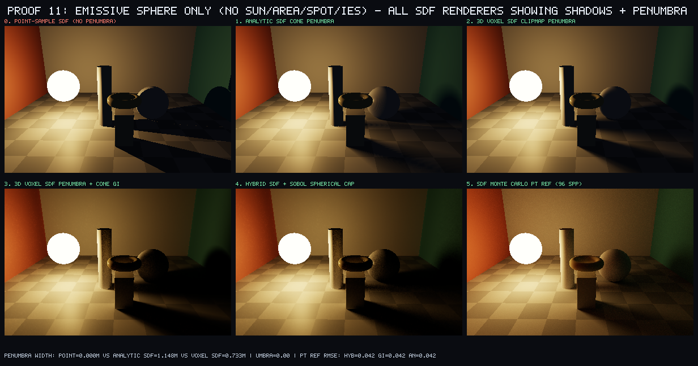

<!--==========================================================================================================================================
                                                              SHADOWPATHS.MD
==========================================================================================================================================-->
<!-- 🧩 User-requested six-path shadow comparison contract and bounded source-reuse audit. -->

# Six requested SDF shadow paths

**Runtime continuation: [all six implementations and actual native renders are now retained](SixRenders.md).**
This document preserves the original requirements and the historical reuse audit on top of
`4cab9133ef01022019f0bf4c71b9b328791306bd`; its scope-only checks are not runtime evidence.
Use the separate render exhibit for current execution, pixels, comparisons and remaining acceptance limits.
The single progress tracker remains [Documentation/Tracker.md](../../Documentation/Tracker.md).



The image above is the original, byte-preserved user attachment, **not a new render or validation result**.
Its captions identify the requested paths. Its penumbra widths, error figures and visual appearance are not
measurements from this checkout and are not adopted as verified results.

## Exact requested selections

| ID  | Label from the image             | Required interpretation                    |
| --- | -------------------------------- | ------------------------------------------ |
| 0   | Point-sample SDF (no penumbra)   | Hard-shadow SDF baseline.                  |
| 1   | Analytic SDF cone penumbra       | Analytic-field soft-shadow approximation.  |
| 2   | 3D voxel SDF clipmap penumbra    | Actual voxel-clipmap field consumption.    |
| 3   | 3D voxel SDF penumbra + cone GI  | Voxel shadows plus reflected-radiance GI.  |
| 4   | Hybrid SDF + Sobol spherical cap | Finite-source visibility with cap samples. |
| 5   | SDF Monte Carlo PT ref (96 spp)  | Finite SDF path-traced lighting reference. |

IDs are the **image's 0–5 numbering**, not the current values of `VisibilityEvaluation`.
Path 3 is a combined shadow/GI configuration; path 5 is a reference renderer, not merely another shadow filter.
The default reference target is **96 paths per pixel**, with its primary/secondary budgets reported separately.
It must never silently mean 96 secondary directions at each of several primary samples.

## Bounded reuse audit

Audited sources are pinned in [the machine-readable audit](Results/ShadowScope.json).
This is source inspection, not a new runtime or full-repository absence certificate.

| ID  | Existing piece at the audited revision | Missing distinction / work                         |
| --- | -------------------------------------- | -------------------------------------------------- |
| 0   | Exact and hybrid binary visibility.    | Both use triangles to decide contact, not SDF.     |
| 1   | Local baked-distance penumbra.         | A sampled vehicle bake is not an analytic field.   |
| 2   | `ClipPenumbra` and raw clip reads.     | Existing candidate remains quality-rejected.       |
| 3   | Real directional radiance cones.       | Coupled voxel-shadow/cone-GI mode and comparisons. |
| 4   | Hybrid march and `CapDirection`.       | Emissive-sphere cap integration and mode tests.    |
| 5   | Triangle `CapturePath` reference.      | Actual SDF intersections/normal evaluation/PT.     |

### Source facts behind the distinctions

- [RadianceScene.h](../../Experimental/DistanceClipmap/RadianceScene.h): `CarOccluded` uses conservative
  clip intervals for empty-space work, then original triangle intersection for unresolved contact.
  It is not a raw hard-shadow SDF hit test.
- `Penumbra` selects `LocalDistance.Sample(...).Raw` or `Clipmap.Sample(...).Raw`.
  Neither converts the local sampled vehicle distance into an analytic primitive field.
- `CapDirection` implements spherical-cap sampling. In current direct integration it is used for the Sun;
  emissive lighting samples the actual vehicle's radiant facets, not an emissive sphere.
- [DirectionalRadiance.h](../../Experimental/DistanceClipmap/Transport/DirectionalRadiance.h) supplies actual
  reflected-radiance cones. Its direct cache currently uses `VisibilityEvaluation::Exact`; the existing GI
  captures do not establish a six-mode voxel-shadow/cone-GI comparison.
- `CapturePath` calls `Scene.Trace` and exact direct visibility. It is a triangle path reference, not path 5.
- The older [distance/cache evidence](README.md) and [GI continuation](Transport.md) remain unchanged.
  Their failed quality/performance gates are not cleared by adding these requested selections.

## Required scenes and isolation

- Preserve the supplied **emissive sphere only** calibration: Sun, rectangle/area, spot and IES contributions
  disabled; no environment, Moon, ambient fill or hidden source may substitute for the sphere.
- Retain actual emissive geometry and record radius/radiance, source visibility, solid-angle PDF, finite segment
  endpoints, receiver cosine and BRDF normalization. Do not replace a finite sphere by an undisclosed point.
- Also test the actual ControlVehicle archives. Do not replace the vehicle with primitives, or treat its
  nonmanifold body as a certified signed solid. Analytic-field calibration and unsigned/baked vehicle coverage
  must be identified separately instead of mislabelling a vehicle bake as analytic SDF.
- Use native 480 × 270 captures: direct-only, GI-only where applicable, combined lighting, visibility/SDF debug,
  source-off black and actual moving-vehicle/source sequences. Debug and beauty outputs must be distinguished.

## Comparison and acceptance contract

| Concern              | Required evidence                                                            |
| -------------------- | ---------------------------------------------------------------------------- |
| Source isolation     | Sphere-only and other isolated sources; all disabled gives exact black.      |
| Shadows              | Umbra/contact, penumbra widening, thin structures, grazing and far shadows.  |
| Fields               | Clear/restore and cull-on/off ablations proving actual SDF/cache reads.      |
| Path 3 attribution   | Compare its shadow component to path 2, then show added GI separately.       |
| Path 5 reference     | Report SDF geometry bias, hit tolerance, step/depth caps and finite noise.   |
| Quality arithmetic   | Direct versus direct; matched-depth GI versus GI, not full PT versus direct. |
| Precision / display  | Declared Float32 transport, common exposure, linear comparisons and mapping. |
| Timing               | Warm/cold costs, identical scene/receiver inputs, repeated fair CPU runs.    |
| GPU                  | Executed Slang, typed layouts, barriers, guarded storage and CPU/GPU parity. |
| Motion / integration | Fresh resets, moving real geometry and user-machine 60/120 Hz verification.  |

A 96-spp image is finitely sampled and can retain SDF geometry/depth bias; it is not noise-free ground truth.
Do not copy the attachment's metric footer, reuse timings from another scene, reduce resolution/precision to
claim speed, or mask errors with undisclosed filtering. Better quality **and** faster remains the requested gate.
SwiftShader CPU checks, when available, do not establish physical-GPU or Windows/editor performance.

## Scope verification

```bash
python3 Exhibits/DistanceClipmap/Code/InspectShadowScope.py
python3 Exhibits/DistanceClipmap/Code/InspectShadowScope.py --check
```

This verifies six exact labels/IDs, the original image hash/extent, pinned code excerpts, local document links
and report consistency. It does not execute any of the six requested shadow paths or certify renderer quality.
[Scope checks](Results/ShadowScopeChecks.json) report that narrow boundary explicitly.
This historical scope audit itself claims no C++/shader build or capture. Current builds and captures are in
[the six-render continuation](SixRenders.md); neither Windows execution nor GitHub Actions is claimed.
