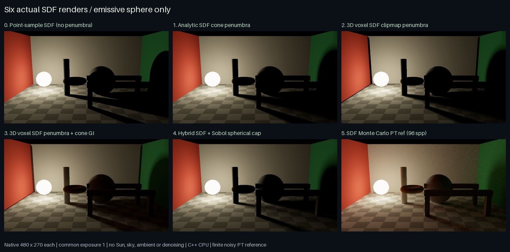
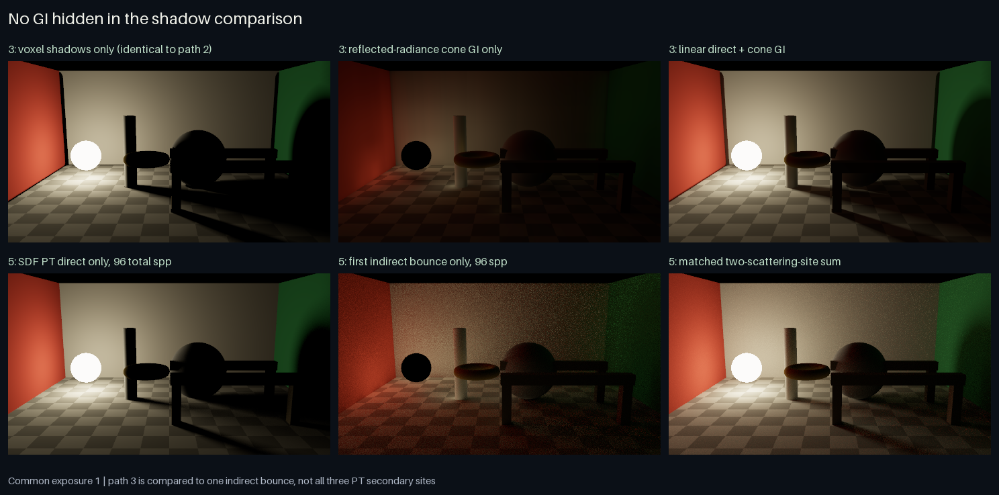
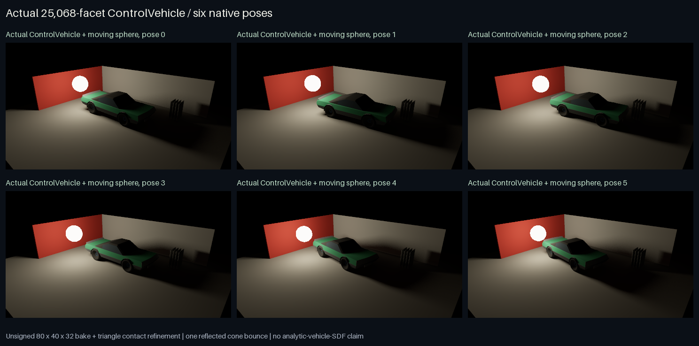

<!--==========================================================================================================================================
                                                              SIXRENDERS.MD
==========================================================================================================================================-->
<!-- 🧩 Six actual SDF renders, retained native pixels, matched-depth GI and bounded execution checks. -->

# Six complete native SDF renders

**Implemented and actually rendered all six requested paths at native 480 × 270.** These are C++ CPU outputs,
not the user's attachment, an illustration, an HTML renderer or native-editor screenshots.
The prototype remains isolated; **production replacement is not accepted**.



[Interactive comparison](Shadows.html) · [Proof 11 banner sheet](Images/Proof11SixSdfRenderers.png) ·
[All six individual PNGs](Results/ShadowSixRenders.zip) ·
[Pixel/runtime summary](Results/ShadowSummary.json) · [Independent integrity](Results/ShadowIntegrity.json) ·
[Original request and historical audit](ShadowPaths.md).

## Executed mechanisms

| ID | Actual implementation                                     | Output                                      |
| -- | --------------------------------------------------------- | ------------------------------------------- |
| 0  | Analytic SDF centre-direction binary visibility.          | [Point sample](Images/Shadow0Combined.png)  |
| 1  | Signed analytic primitives, distance/cone penumbra.       | [Analytic cone](Images/Shadow1Combined.png) |
| 2  | Three Float32 signed voxel levels, trilinear penumbra.    | [Voxel clips](Images/Shadow2Combined.png)   |
| 3  | Path 2 shadows + real reflected-radiance voxel cones.     | [Cone GI](Images/Shadow3Combined.png)       |
| 4  | Conservative voxel skips, SDF contact, Sobol sphere cap.  | [Hybrid cap](Images/Shadow4Combined.png)    |
| 5  | SDF-only intersections/normals, diffuse NEE path tracing. | [96-spp SDF PT](Images/Shadow5Combined.png) |

- The calibration room contains signed closed boxes, a capped cylinder, torus and sphere. All primary geometry
  and the reference use analytic signed-distance marching, **not triangle intersection**.
- Path 0 samples the shadow direction once, not a replacement point emitter: its cosine/solid-angle integral
  still covers the same finite sphere. Paths 1/2/3 use the approximate `min(h / (t tan α))` cone visibility.
- Path 2/3 actually sample `64³ × 3` signed-distance grids, spacing **0.0625 / 0.125 / 0.25 m**. The calibration
  clip centre is fixed and these levels rebuild on change. Unknown coverage refines analytic SDF, never empty sky.
- Path 3 injects reflected outgoing radiance lit by **path 2**, not exact-triangle shadows or constant ambient.
  Three `64³` radiance levels have six directional lobes, seven mips and **16 finite cones**. This is one reflected
  diffuse bounce; offset **0.16 m**, initial travel **0.125 m**. It loses near-field/detail information.
- Path 4 uses a conservative Lipschitz lower bound for empty-space skips. Steps account for the hit tolerance;
  ambiguous proximity/exhaustion refines the **original SDF segment**, never a displaced triangle ray.
- Path 5 has **96 total paths per pixel = four common primary positions × 24 paths**, not 96 secondary paths at
  each primary. Each visited diffuse site has one independent cap-NEE sample and a cosine continuation.
  Maximum **four scattering sites**: primary + three secondary. Secondary emitter hits do not add Le twice.

## Shared radiometry / precision

| Input / rule             | Declared configuration                                                   |
| ------------------------ | ------------------------------------------------------------------------ |
| Only source              | Opaque emissive sphere; no Sun, area/rectangle, point, spot, IES, sky.   |
| Sphere centre / radius   | `(-2.45, 1.60, 0.72) m` / `0.43 m`.                                      |
| Sphere radiance          | Linear RGB `(35, 30, 21)`, relative radiance units.                      |
| Visibility segments      | Receiver offset to the near sphere intersection, minus `0.002 m`.        |
| Cap proposal             | Uniform solid angle; PDF `1 / Ω`, `Ω = 2π (1 − cos α)`.                  |
| Cosine / diffuse BRDF    | `Le × visibility × cos θ × Ω × ρ / π`; no duplicated inverse square.     |
| Materials                | Bounded matte Lambertian diagnostics, not the production PBR library.    |
| Transport / comparisons  | Float32; linear Float64 reductions only for reported errors/display.     |
| Display                  | Same exposure **1**, Reinhard `x / (1 + x)`, IEC sRGB.                   |
| Filtering                | No denoiser, temporal reconstruction, bloom or concealed ambient.        |
| SDF bounds               | `0.0004 m` hit tolerance, `0.002 m` offset, 256 steps, 40 m trace bound. |

`R² / d² / (1 + cos α)` avoids cancellation in the cap solid angle. Finite-source visibility is evaluated at
its actual finite endpoint. Unobstructed sphere irradiance matches the independent projected-solid-angle
formula to **9.254e−6 relative** in the 65,536-direction Float32 check.

The four primary positions are deliberately shared by all paths. Their reuse is disclosed rather than
claiming 96 independent primary camera positions. This finite reference has SDF tolerance, depth and noise bias;
it is **not noise-free ground truth** or a triangle-geometry reference for the vehicle.

## Shadow versus GI attribution



- Path 3 direct RGB is **bit-identical to path 2**. Its added indirect light cannot improve that shadow score.
- Compare its GI to `Shadow5OneBounce`, the reference's first secondary site, not its full three-site indirect.
  `Shadow5TwoSites` is the linear sum of retained reference direct + first-bounce buffers.
- Direct error maps use direct versus direct. Metrics are reduced before display over all pixels, fully opaque
  receivers excluding the emitter, and floor-only receivers. [Exact arithmetic](Results/ShadowSummary.json).
- Paths 0/1/2/4 have zero GI by definition. Every off-state full native image is exactly black.
  Diagnostic visibility/signed slices have explicitly different mappings; error images are labelled **×8**.

## Verification

| Executed check                 | Observed result                                                |
| ------------------------------ | -------------------------------------------------------------- |
| Native requested selections    | Six actual 480 × 270 C++ outputs, plus complete decomposition. |
| Numeric assertions             | **18,251**, including independent normals and radiometry.      |
| SDF cap visibility             | **7,980** segments, zero hybrid/binary differences.            |
| Hybrid consumption             | **80,382** voxel skips, **1,815** original-SDF refinements.    |
| Contact / grazing / far        | **256** independent slab comparisons, 5 mm blocker, to 24 m.   |
| Finite penumbra profiles       | Four distances × 385 sites × 1,024 cap directions.             |
| Source-off native room         | **777,600** pixels exactly black across all six selections.    |
| Source-off actual vehicle      | **129,600** pixels exactly black.                              |
| CPU/Vulkan image integration   | All six selections on **288** stratified pixels each.          |
| GPU signed geometry probes     | **288**, hit/position/normal/signed-distance differences zero. |
| CPU/GPU maximum direct error   | **2.3842e−7**; maximum indirect error **5.9605e−8**.           |
| GPU storage                    | Nine executed entries, eight SSBOs, 128 B pushes, 64 B tails.  |
| GPU clear / restore / cull off | Actual resident-input ablations; restore and cull RGB exact.   |
| Moving SDF primitive / source  | Refreshed GPU lighting matches CPU; 221 tested pixels change.  |
| Native CTests                  | **2/2**, CPU numeric and executed software Vulkan.             |
| ASan + UBSan                   | Native numeric + Vulkan-host runs finish without findings.     |

[Numeric report](Results/ShadowNumeric.json) · [Capture parameters](Results/ShadowCapture.json) ·
[Vulkan report](Results/ShadowVulkan.json) · [CTest log](Results/ShadowCTest.txt) ·
[CPU sanitizers](Results/ShadowSanitizersCpu.txt) · [Vulkan-host sanitizers](Results/ShadowSanitizersVulkan.txt).
External Vulkan driver/shaders are not sanitizer-instrumented; external-driver leak checks are disabled.
An independently configured **Vulkan-OFF build passes 1/1** and produces byte-identical native capture hosts.
Earlier diffuse-transport **2/2** and distance/cache **4/4** CTests pass again:
[continuation regression log](Results/ShadowRegressions.txt).

Independent validation regenerates the nine exact executed shader byte streams and typed reflection, rejects a
misaligned primitive layout and the reproduced builtin-trig defect, checks retained Float32/PNG/ZIP pixels,
recomputes matched-depth errors and checks every benchmark repeat against the captured Float32 image.
The [browser report](Results/ShadowPresentation.json) exercises all five image views × six algorithms, all six
actual vehicle poses, explicit playback, reduced motion, 390 × 844 layout, links and missing/failed integrity.
[Desktop capture](Images/ShadowBrowserDesktop.png) · [Mobile capture](Images/ShadowBrowserMobile.png).

The separate calibration blocker gives measured 10–90% penumbra widths **0.10543 / 0.30739 / 0.60947 / 1.21625 m**
at receiver separations **0.5 / 1.5 / 3 / 6 m**. These are new 1,024-direction measurements, **not** the attachment's
footer or widths measured on the beauty-render rod. [Profiles](Images/ShadowProfiles.png) ·
[Native profile samples](Results/ShadowProfiles.csv).

### Corrections exercised during implementation

| Reproduced issue                                  | Correction and retained regression                              |
| ------------------------------------------------- | --------------------------------------------------------------- |
| Device trig moved a PT hit across a checker edge. | Shared Float32 azimuth polynomial; unchanged parity thresholds. |
| Clip steps changed a hit-tolerance shadow fringe. | Tolerance-aware skips + original-segment SDF refinement.        |

The azimuth polynomial's independent host trig error is **1.7882e−7**. The previously failing receiver, pixel
**36347**, now has exact CPU/GPU directions, positions, normals and reflectance across 96 path probes.
The independent validator recompiles a **builtin-sin/cos negative control** and requires the unchanged parity
threshold to reject it; see [the control log](Results/ShadowBuiltinAzimuthControl.txt). Passing the new probe
is not achieved by blurring pixels, moving the checker, increasing thresholds or relabelling triangle traces.

## Actual moving vehicle companion



- Reuses all **25,068 actual archived facets**, production `TriangleVisibilitySpace` bounds, the existing
  **unsigned 80 × 40 × 32** local bake and three **48³ toroidal** clips. Vehicle contact still uses original
  triangles; this is explicitly **not an analytic signed vehicle** or six new vehicle-specific SDF modes.
- Sphere-only diffuse direct light relights the actual directional surface cache. Archived vehicle emitters,
  Sun, rectangle, environment and ambient fill are not used. The car is opaque/matte for this diagnostic.
- Six prescribed rigid/source poses compare full native direct/GI/combined images to fresh reconstruction:
  exact equality. Cold clips also match; **6,144** visibility segments have zero triangle/hybrid differences.
  **18,204** bake march steps and **468** empty marched segments prove actual bake consumption.
- Surface-cache clear removes all GI without changing direct; restore is exact. Six stale pose/source uses are
  rejected. [Report](Results/ShadowVehicle.json) ·
  [Lossless native-pose animation](Images/ShadowVehicleCombinedMotion.png).
- This exercises actual geometry motion, **not controlled driving physics, engine scene ownership or frame pacing**.

Every native PNG and raw-Float32 digest is retained. To respect the cumulative repository evidence budget,
**15 moving-vehicle Float32 payloads are omitted**; their PNGs, digests and lossless APNGs remain. Static/reference,
visibility, signed-debug and vehicle pose-0 Float32 payloads are losslessly compressed, with identical buffers
aliased rather than duplicated. [Exact retention inventory](Results/ShadowSummary.json).

## Timing and remaining acceptance

[Five-round timing chart](Images/ShadowTimings.png) · [Raw timing samples](Results/ShadowBenchmark.csv) ·
[Conditions / cold costs](Results/ShadowBenchmark.json).

| ID | Median CPU transport | Direct linear RGB RMSE versus finite 96 spp |
| -- | -------------------- | ------------------------------------------ |
| 0  | 967.22 ms            | 0.00386617                                 |
| 1  | 1,081.57 ms          | 0.00481073                                 |
| 2  | 859.24 ms            | 0.03572086                                 |
| 3  | 8,699.87 ms          | 0.03572086                                 |
| 4  | 17,403.40 ms         | 8.4696e−8                                  |
| 5  | 43,861.41 ms         | 0, reference compared with itself           |

Path 3's matched first-indirect-bounce RGB RMSE is **0.05992272**, and its matched two-site combined RMSE
is **0.07445433**. Those include finite reference noise, not just approximation error. The separate direct-only
96-spp reference takes **10,925.88 ms**: hybrid path 4 is slower here, not a demonstrated acceleration.
Cold distance/radiance construction is **450.89 ms** and common primary tracing is **349.22 ms**.

- Two-thread CPU, one warmup round, five forward/reverse rounds, identical primary sites and source inputs;
  every repeated Float32 output is bit-identical. Allocation/integration is timed; primary tracing, field/cache
  construction, hashing and encoding are separate. Selection 6 is a **direct-only 96-spp SDF reference** for timing,
  not a seventh requested path.
- Do not compare full depth-four PT to a direct-only approximation as equal-quality work. Likewise path 3's GI
  has only one secondary site and loses energy/detail; the voxel path has visible corner/contact artifacts.
- Runtime and evidence checks pass, **not visual/production acceptance**. The previous rejected GI methods remain
  rejected. These new renders do not establish better quality **and** faster production replacement.
- Tested here: **Linux x86-64, GCC 12.2, C++20, strict Float32, Slang SPIR-V, SwiftShader CPU device type 4**.
  Source identity is `9d24845` plus the separately SHA-256-listed working-tree implementation in the summary.
  No production/editor target was modified and no GitHub Actions run was requested or performed.
- **Not verified:** Windows/MSVC execution or Windows binaries, physical GPUs, full-GPU scene rendering, native
  editor integration, asynchronous/device-local storage, driving physics, acceptable 60/120 Hz pacing.

## Reproduce locally

Prerequisites: C++20 compiler, CMake ≥3.20, threads, Python with NumPy/Pillow. Optional GPU checks need Vulkan
headers/library, Slang `slangc` and an explicit compatible driver **shared library**, not an ICD JSON file.
A Linux loader may also require `VK_ICD_FILENAMES` and `LD_LIBRARY_PATH` for that installed driver; an explicit
library argument does not override the loader's own discovery. Paths below are repository-relative; build
products/raw PFM evidence remain ignored. Use a build-directory configuration appropriate to your generator.

```bash
cmake -S Experimental/DistanceClipmap/Shadows -B _ClaudeScratch/build/SdfShadows \
  -DCMAKE_BUILD_TYPE=Release -DFRONTIER_SHADOW_VULKAN=ON \
  -DFRONTIER_SHADOW_SLANG=/path/to/slangc \
  -DFRONTIER_SHADOW_DRIVER=/path/to/vulkan/driver
cmake --build _ClaudeScratch/build/SdfShadows --config Release
ctest --test-dir _ClaudeScratch/build/SdfShadows --output-on-failure

_ClaudeScratch/build/SdfShadows/SdfShadowValidation _ClaudeScratch/tmp/ShadowFinal/Numeric validate
_ClaudeScratch/build/SdfShadows/SdfShadowValidation _ClaudeScratch/tmp/ShadowFinal/Room render
_ClaudeScratch/build/SdfShadows/SphereVehicleValidation \
  Experimental/SlateReference/B/Exhibits/IlluminationHost/Archive _ClaudeScratch/tmp/ShadowFinal/Vehicle
_ClaudeScratch/build/SdfShadows/SdfShadowVulkan _ClaudeScratch/build/SdfShadows/Shaders \
  _ClaudeScratch/tmp/ShadowFinal/Vulkan /path/to/vulkan/driver validate
_ClaudeScratch/build/SdfShadows/SdfShadowValidation _ClaudeScratch/tmp/ShadowFinal/Benchmark benchmark

python3 Exhibits/DistanceClipmap/Code/InspectShadows.py _ClaudeScratch/tmp/ShadowFinal \
  --build-directory _ClaudeScratch/build/SdfShadows
python3 Exhibits/DistanceClipmap/Code/ValidateShadows.py \
  --build-directory _ClaudeScratch/build/SdfShadows --compiler /path/to/slangc --driver /path/to/vulkan/driver
python3 Exhibits/DistanceClipmap/Code/ServeShadows.py --port 4175
```

In another terminal with working Chromium/runtime/fonts (browser checks are not native-editor evidence):

```bash
npm install --prefix _ClaudeScratch/tmp/EvidenceBrowser --save-exact playwright-core@1.56.1
export NODE_PATH="$PWD/_ClaudeScratch/tmp/EvidenceBrowser/node_modules"
CHROMIUM_EXECUTABLE="$(command -v chromium)" \
  node Exhibits/DistanceClipmap/Code/ValidateShadowPresentation.cjs http://127.0.0.1:4175
```

For CPU-only builds, omit the three Vulkan options; both native capture executables still build. The retained
inspection/validation recipe deliberately requires the executed optional Vulkan report, not a fabricated CPU
substitute. On Windows, use the actual `.exe`/configuration paths and compatible toolchain/driver; no Windows
build or execution is claimed. Local ASan/UBSan builds use `-fsanitize=address,undefined -fno-omit-frame-pointer`
with `-O1 -g`; exact build/test results are under `Results/Shadow*.txt`.
